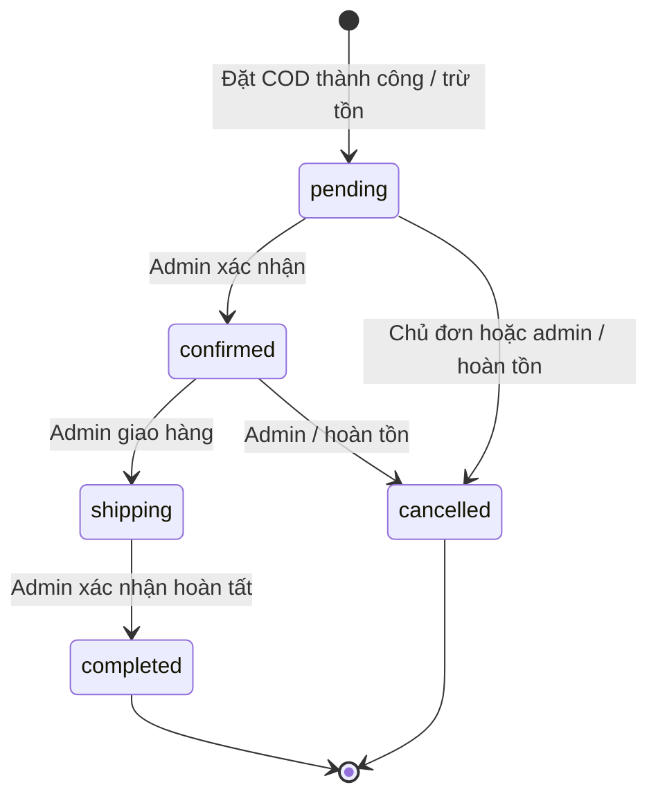

# Thiết kế Checkout COD và Orders — Issue #20

**Trạng thái: DRAFT / CHỜ QUÂN VÀ HẢI REVIEW.** Ngày lập: 17/11/2026.
Người chuẩn bị: Codex theo yêu cầu Đinh Công Phúc. Không phải contract đã duyệt.
Phạm vi bản thiết kế: chưa tạo migration/RPC, chưa sửa Flutter production và chưa deploy cloud. Việc đưa tài liệu lên nhánh/Draft PR phục vụ review không phải triển khai backend hoặc phê duyệt contract.

## 1. Căn cứ, phạm vi và kết quả kiểm tra

- Đã fetch origin ngày 17/11; main local và origin/main cùng ở `b7c92a67f1936b10d9298f2e0d8606440180f3de`, ahead/behind 0/0. Working tree sạch trước khi tạo tài liệu này.
- P01 `a504ba1` và P02 `530f5a1` đã có trong main; không cần tích hợp lại.
- Đọc trực tiếp GitHub [#20](https://github.com/QuanLV2k5/smart-fashion-shopping-app/issues/20): Open, assignee DinhCongPhuc, cập nhật 17/11 lúc 10:08:13 UTC+7, chưa có bình luận tại lần kiểm tra.
- Đối chiếu [#18 Reviews/users của Quân](https://github.com/QuanLV2k5/smart-fashion-shopping-app/issues/18) và [#19 Admin Catalog của Hải](https://github.com/QuanLV2k5/smart-fashion-shopping-app/issues/19).
- Nguồn nội bộ: [contracts](contracts.md), [R4](../planning/Ke-hoach-hoan-thien-25-11-2026.md), [design handoff](../design-handoff.md), [P02 handoff](../p02-addresses-handoff.md).
- Code đã đọc: [schema nền](../../supabase/migrations/20261108000100_initial_foundation.sql), [Cart SQL](../../supabase/migrations/20261109000100_product_cart.sql), [Cart domain](../../lib/features/cart/domain/cart.dart), [repository](../../lib/features/cart/data/supabase_cart_repository.dart), [Riverpod](../../lib/features/cart/presentation/cart_providers.dart), [Addresses domain](../../lib/features/addresses/domain/address.dart), [repository](../../lib/features/addresses/data/supabase_address_repository.dart), [Riverpod](../../lib/features/addresses/presentation/address_providers.dart).
- Có quyền đọc Figma qua MCP; đã xem metadata và render 5 màn chính, đối chiếu metadata các trạng thái liên quan ở mục 13. Không sửa Figma, không playtest prototype.
- Không truy cập Supabase cloud. Schema và quyền dưới đây là thiết kế trên source, không phải xác nhận trạng thái database live.

**Yêu cầu đã có:** Phúc làm backend/UI/test P04/P05/P06; Quân review transaction, Hải review contract/UI. Chốt contract 18/11, RPC chạy thật 19/11, flow hết 21/11. COD server transaction, snapshot, idempotency, quyền khách/admin, hoàn tồn khi hủy và API/RLS thật là AC bắt buộc.

**Đề xuất của tài liệu:** mọi tên RPC/bảng/cột mới, TTL, giới hạn, phí ship áp dụng chung, quyền hủy, retention và giao thức tồn kho cần nhóm xác nhận ở mục 15. Không tự thay contracts.md hiện có.

Không làm thanh toán online, ship tích hợp, hoàn hàng sau giao, chỉnh sửa đơn sau đặt hoặc dashboard P10 trong #20. Schema vẫn cung cấp đầu vào thống kê cho #21.

## 2. Hiện trạng và nguyên tắc bất biến

1. Cart có `get_cart()` và `mutate_cart(...)`; quantity 1–99, khóa `(user_id, variant_id)`. Cart **không giữ chỗ/trừ tồn**.
2. Cart mutation dùng advisory transaction lock `hashtextextended(caller::text, 0)`, receipt `(user_id, request_id)` và kiểm tra caller. Orders phải dùng cùng khóa user khi đụng giỏ.
3. Giá hiện đặt ở `products.price_vnd`; stock ở variant; sản phẩm chỉ bán khi product visible và category active.
4. Addresses có RLS ownership; selected address lưu local theo user. Lựa chọn local không cấp quyền đặt đơn.
5. Role lấy từ `user_roles`/`private.is_admin()`, không từ client metadata. RPC security definer phải tự kiểm tra quyền, không dựa vào RLS bị bypass.
6. Không tin tiền/stock/user/status do client gửi. Không có thao tác ghi trực tiếp Orders từ client, kể cả admin.
7. Một lần đặt thành công = đơn + items + event đầu + trừ tồn + dọn giỏ + receipt + consume quote cùng commit.
8. Snapshot tiền/hàng/địa chỉ không thay đổi theo dữ liệu live; trạng thái đơn chỉ thay qua state machine.
9. Retry thành công trả lại kết quả đã commit; không tính đơn lần hai. Timeout client không chứng minh rollback server.
10. Lỗi quyền/stock/giá thật chặn bàn giao; đóng S1 không thay thế bằng chứng backend #20.

## 3. Checkout và quote v1 — đề xuất cụ thể

### 3.1 Phạm vi mua và giới hạn

- Checkout mua **toàn bộ giỏ server của caller** tại lần quote; chưa có checkbox chọn một phần giỏ hoặc buy-now riêng.
- Quote và place không nhận danh sách hàng, user ID hoặc tiền từ client. Input quote chỉ `address_id`; server tự đọc giỏ.
- Tối đa 100 dòng variant khác nhau, mỗi dòng 1–99; giỏ rỗng bị từ chối. Đây là giới hạn mới cần duyệt; không âm thầm sửa quantity đang có.
- Tiền integer VND; tính bằng PostgreSQL bigint, tổng tối đa đề xuất `9000000000000` VND (< giới hạn integer chính xác của JavaScript). Không dùng float cho tính tiền.

### 3.2 Quy trình

1. Client xác nhận không còn Cart mutation pending/uncertain, chọn địa chỉ và gọi `create_checkout_quote` bằng POST.
2. Server lấy user lock, đọc địa chỉ thuộc caller và toàn giỏ; kiểm tra catalog/stock; lưu quote immutable trong schema private.
3. UI hiển thị **response server**: hàng, địa chỉ, subtotal, shipping, total, COD. Quote không giữ tồn.
4. Quote hết hạn sau **300 giây**; UI có nút tải lại khi stale/expired. Lấy `clock_timestamp()` sau chờ lock để kiểm tra thời hạn; không dùng thời gian đầu transaction cho TTL.
5. Khi người dùng bấm đặt, sinh UUID request một lần; lưu pending trước khi gửi `place_cod_order(quote_id, request_id)`.
6. Server kiểm tra receipt trước điều kiện quote/current data; nếu chưa có thì khóa và tái xác minh quote/current data rồi đặt atomically.
7. Chỉ chuyển màn thành công khi nhận kết quả đã commit, hoặc lookup xác nhận request đã thành công.

Quote snapshot gồm giỏ chuẩn hóa, hàng/giá/variant/ảnh, địa chỉ và rule ship. Tại place:

- Toàn bộ tập variant/quantity hiện tại phải khớp quote; kể cả dòng mới thêm hoặc bị xóa. Khác thì `SF_CART_CHANGED`, không tự mua phần còn lại.
- So nội dung address snapshot, product/variant metadata được snapshot, giá và ship rule với bản quote. Thay đổi thì `SF_QUOTE_STALE`, yêu cầu xem quote mới rồi xác nhận lại.
- Không so stock bằng tuyệt đối với stock cũ: chỉ cần stock hiện tại đủ và catalog vẫn bán; nếu thiếu trả `SF_STOCK_CHANGED`.
- Không dùng `updated_at` chung của variant làm dấu stale giá: stock thay đổi cũng cập nhật timestamp. So các trường nghiệp vụ cụ thể.
- Quote chỉ consume khi đặt thành công; unique `orders.checkout_quote_id` chặn request ID mới tạo đơn thứ hai từ cùng quote.
- Nếu dữ liệu đổi sau quote, **không tự dùng giá/địa chỉ mới** dù total tình cờ bằng nhau.
- Tối đa 10 quote chưa hết hạn/chưa dùng mỗi user; quote không trả công khai, không tạo hold kho. Hết giới hạn trả lỗi có thể hiểu được; không tự xóa quote còn hiệu lực đang mở ở thiết bị khác.

### 3.3 Phí ship

Đề xuất S2 dùng server rule `flat_cod_v1`: **25.000 VND/đơn có hàng**, áp dụng mọi địa chỉ hợp lệ trong phạm vi demo; không miễn phí theo ngưỡng, không chia kiện, không surcharge theo quantity.

- Đây là chính sách đề xuất từ giá trị demo Figma/Issue, chưa phải cam kết giao hàng thực tế toàn quốc.
- Rule nằm trong helper server versioned, không hardcode tổng trong Flutter. Snapshot `shipping_rule_version` và `shipping_vnd` vào quote/order.
- Giỏ rỗng không tạo quote; không tính đơn 25.000đ chỉ có ship.
- Đổi rule làm quote cũ stale, không đổi ship đơn đã tạo. Ship không tính vào budget outfit AI.
- Fixture: 199000 + 249000 = 448000; ship25000; total473000.

### 3.4 DTO quote

Input `create_checkout_quote(p_address_id uuid)`; toàn bộ UUID minh họa trong tài liệu phải thay bằng ID thật của fixture được phép khi test.

```json
{
  "schema_version": 1,
  "quote_id": "11111111-1111-4111-8111-111111111111",
  "expires_at": "2026-11-18T03:05:00Z",
  "currency": "VND",
  "payment_method": "cod",
  "address": {
    "address_id": "22222222-2222-4222-8222-222222222222",
    "recipient_name": "Khách thử nghiệm",
    "phone": "0900000000",
    "address_line": "Địa chỉ fixture",
    "ward": "Phường fixture",
    "district": "Quận fixture",
    "city": "Đà Nẵng"
  },
  "items": [
    {
      "product_id": "33333333-3333-4333-8333-333333333333",
      "variant_id": "44444444-4444-4444-8444-444444444444",
      "product_code": "SF01",
      "product_name": "Áo thun Essential",
      "sku": "SF01-WHITE-M",
      "size": "M",
      "color": "Trắng ngà",
      "image_paths": [],
      "quantity": 1,
      "unit_price_vnd": 199000,
      "line_total_vnd": 199000
    }
  ],
  "subtotal_vnd": 199000,
  "shipping_vnd": 25000,
  "shipping_rule_version": "flat_cod_v1",
  "total_vnd": 224000
}
```

Ví dụ JSON trên là đơn một món; bộ hai món của demo trả hai items và total473000. Không đưa số điện thoại/địa chỉ của thành viên thật vào fixture tài liệu.

### 3.5 Request đặt và response

```json
{
  "p_quote_id": "11111111-1111-4111-8111-111111111111",
  "p_request_id": "55555555-5555-4555-8555-555555555555"
}
```

```json
{
  "schema_version": 1,
  "replayed": false,
  "result": {
    "request_id": "55555555-5555-4555-8555-555555555555",
    "order_id": "66666666-6666-4666-8666-666666666666",
    "order_number": "SF-000001",
    "status_at_creation": "pending",
    "currency": "VND",
    "payment_method": "cod",
    "subtotal_vnd": 199000,
    "shipping_vnd": 25000,
    "total_vnd": 224000,
    "created_at": "2026-11-18T03:01:00Z"
  }
}
```

`result` bất biến được lưu trong receipt; replay chỉ đổi `replayed=true`. Status hiện tại và toàn bộ items/address/time lấy qua `get_order`. Không nhầm `status_at_creation` với trạng thái hiện tại sau admin cập nhật. Order number là sequence server format `SF-` + số ít nhất 6 chữ số; không hardcode `SF261108` trong prototype. Sequence có thể có khoảng trống khi rollback, không dùng để suy tổng số đơn.

## 4. State machine, hủy và hoàn tồn



| Status | Nhãn UI | Người được chuyển tiếp | Allowed next |
|---|---|---|---|
| `pending` | Chờ xác nhận | Admin; owner chỉ được hủy | `confirmed`, `cancelled` |
| `confirmed` | Đã xác nhận | Admin | `shipping`, `cancelled` |
| `shipping` | Đang giao | Admin | `completed` |
| `completed` | Hoàn tất | Không ai trong scope S2 | Không |
| `cancelled` | Đã hủy | Không ai trong scope S2 | Không |

- Không nhảy bước, lùi trạng thái hoặc cập nhật cùng status bằng request mới. Retry đúng request cũ trả receipt trước kiểm tra version.
- `version` bắt đầu1, tăng1 mỗi transition. Caller gửi `expected_version`; stale trả `SF_ORDER_VERSION_CONFLICT`, tải lại trước quyết định mới.
- Hủy yêu cầu reason code giới hạn: owner `customer_requested`; admin `customer_requested`, `cannot_fulfill`, `duplicate_confirmed`. Không có text nội bộ tùy ý trong timeline công khai.
- Trừ tồn ngay khi tạo đơn, không trừ lại lúc confirmed/shipping/completed.
- Hủy hợp lệ khóa order rồi variants, cộng lại quantity snapshot; set `stock_restored_at`, đổi status và ghi event trong cùng transaction. Chỉ từ trạng thái chưa hoàn; điều kiện version/status/marker chặn hoàn tồn hai lần.
- Hủy không tự đưa hàng lại vào giỏ, không gọi API hoàn tiền COD. Không hủy shipping/completed; giao thất bại/return là scope khác cần quyết định mới.
- `completed` là trạng thái nghiệp vụ cho Reviews, **không tự chứng minh đã đối soát tiền mặt**. #21 gọi tổng giá trị đơn hoàn tất, không gọi doanh thu thực thu.

## 5. Schema PostgreSQL đề xuất (chỉ đặc tả, chưa có DDL)

Mọi cột dưới đây NOT NULL trừ cột ghi nullable; UUID do server tạo trừ request_id client. Thời gian timestamptz, lưu UTC; UI hiển thị Asia/Ho_Chi_Minh. Tiền bigint; snapshot nghiệp vụ bất biến, không upsert theo dữ liệu live.

### 5.1 `public.orders`

| Cột | Kiểu / constraint |
|---|---|
| `id` | uuid PK |
| `order_number` | text UNIQUE; sinh từ sequence server |
| `user_id` | uuid FK auth.users, ON DELETE RESTRICT; index |
| `checkout_quote_id` | uuid UNIQUE, ID nguồn; không FK sang quote để cho phép dọn quote private sau retention |
| `source_address_id` | uuid nullable, ID tham chiếu lịch sử, không FK/live join; không đổi khi địa chỉ xóa |
| `recipient_name`, `phone`, `address_line`, `ward`, `district`, `city` | text snapshot; giới hạn/ràng buộc theo Addresses hiện tại, không cần đọc live để render |
| `status` | text CHECK thuộc 5 giá trị mục4, default pending |
| `version` | integer >=1 |
| `currency`, `payment_method` | text CHECK VND / cod |
| `subtotal_vnd`, `shipping_vnd`, `total_vnd` | bigint: subtotal>0, shipping>=0, total=subtotal+shipping, total<=9000000000000 |
| `shipping_rule_version` | text, ví dụ flat_cod_v1 |
| `stock_deducted_at` | timestamptz; cùng thời điểm đặt |
| `stock_restored_at` | timestamptz nullable; CHECK có giá trị iff status=cancelled |
| `created_at`, `updated_at` | timestamptz |
| `completed_at`, `cancelled_at` | timestamptz nullable; CHECK tương ứng iff status completed/cancelled |

Index: `(user_id, created_at DESC, id DESC)`, `(status, created_at DESC, id DESC)`, index created_at/id cho admin all. Không cho xóa đơn qua app. ON DELETE RESTRICT user là đề xuất retention, cần Quân chốt với admin users: quản lý trạng thái truy cập, không xóa Auth user có đơn. Chính sách xóa/ẩn danh dữ liệu sau dự án cần quyết định riêng, không coi lưu PII vĩnh viễn là đã duyệt.

### 5.2 `public.order_items`

| Cột | Kiểu / constraint |
|---|---|
| `id` | uuid PK |
| `order_id` | uuid FK orders ON DELETE RESTRICT; index |
| `line_no` | integer 1..100; UNIQUE(order_id,line_no) |
| `product_id` | uuid FK products ON DELETE RESTRICT; index phục vụ review |
| `variant_id` | uuid FK product_variants ON DELETE RESTRICT; UNIQUE(order_id,variant_id) |
| `product_code`, `product_name`, `sku`, `size`, `color` | text snapshot; giới hạn như schema nguồn |
| `image_paths` | text[] snapshot, có thể rỗng; placeholder nếu ảnh không tải được |
| `quantity` | integer CHECK 1..99 |
| `unit_price_vnd` | bigint >0 |
| `line_total_vnd` | bigint generated/constraint bằng unit_price_vnd*quantity |
| `created_at` | timestamptz |

RPC phải xác minh variant thuộc product, tổng items khớp subtotal và 1..100 items. CHECK của một dòng không kiểm chứng tổng bảng con: dùng deferred constraint trigger khi thực thi migration để bảo vệ tổng/ít nhất một item tại commit, đồng thời giữ test RPC. Không có đường sửa snapshot qua API. Catalog đã có đơn chỉ ẩn/ngừng bán, không hard delete. FK RESTRICT giữ product identity cho Reviews và biến thể cho hoàn tồn.

### 5.3 `public.order_status_events`

| Cột | Kiểu / constraint |
|---|---|
| `id` | uuid PK |
| `order_id` | uuid FK orders ON DELETE RESTRICT |
| `version` | integer >=1; UNIQUE(order_id,version), cũng là thứ tự timeline |
| `from_status` | text nullable chỉ event đầu; CHECK enum |
| `to_status` | text CHECK enum |
| `actor_user_id` | uuid FK auth.users ON DELETE RESTRICT; audit server, không trả customer |
| `actor_role` | text CHECK customer/admin, từ server; user có role admin vẫn có thể tạo đơn của chính mình |
| `reason_code` | text nullable; bắt buộc cho cancelled, whitelist theo mục4 |
| `created_at` | timestamptz |

Event đầu `version=1, from_status=null, to_status=pending`. Append-only. RPC/constraint trigger giữ latest event khớp orders.status/version. Direct SELECT của client chỉ grant danh sách cột an toàn, không grant actor_user_id; read RPC trả DTO tương đương. Không ghi token, JWT, private admin notes vào event.

### 5.4 `private.checkout_quotes`

| Cột | Kiểu / constraint |
|---|---|
| `id` | uuid PK |
| `user_id` | uuid FK auth.users ON DELETE RESTRICT |
| `schema_version` | integer CHECK 1 |
| `canonical_snapshot` | jsonb do server tạo: address + all cart lines + các snapshot hàng + tiền/rule; shape được helper kiểm tra |
| `created_at`, `expires_at` | timestamptz, expires_at>created_at |
| `consumed_order_id` | uuid nullable UNIQUE FK orders ON DELETE RESTRICT |

Index `(user_id, expires_at)`. Không expose/private GRANT cho client. Unused quote hết hạn có thể dọn bằng tác vụ quản trị đã review. Quote consumed có thể dọn sau retention do receipt/order giữ kết quả; đề xuất giữ trong suốt đợt UAT, chưa tự lên lịch cleanup. Giới hạn quote và cleanup cần tính khi triển khai, không để bảng PII tăng vô hạn.

### 5.5 `private.order_requests` (receipt dùng chung cho các mutation Orders)

| Cột | Kiểu / constraint |
|---|---|
| `user_id`, `request_id` | uuid; PK(user_id,request_id). user_id là **caller/actor**, không phải owner của đơn khi admin thao tác |
| `operation` | text CHECK place_cod_order/change_order_status |
| `canonical_payload` | jsonb NOT NULL, chuẩn hóa server; không lưu raw HTTP/JWT |
| `order_id` | uuid FK orders ON DELETE RESTRICT |
| `result` | jsonb kết quả immutable đã commit, schema_version1; summary, không nhân bản địa chỉ/phone |
| `created_at` | timestamptz |

FK user_id auth.users ON DELETE RESTRICT. Index order_id. RLS bật, revoke mọi quyền client, không expose schema. Chỉ receipt **thành công** tồn tại; lỗi phải rollback cả receipt. Giữ receipt ít nhất suốt vòng đời đơn trong scope hiện tại, không TTL ngắn làm mất chống trùng. Cleanup/retention dài hạn cần quyết định riêng. Dùng JSONB equality với payload chuẩn hóa để tránh phụ thuộc extension hash; có thể thêm digest sau nhưng không thay kiểm tra nội dung.

## 6. API/RPC v1

Các endpoint gọi `/rest/v1/rpc/<name>`, JWT user và publishable key thông thường. Không đưa service_role vào Flutter. Tên là đề xuất, không overload cùng tên nhiều signature gây mơ hồ schema cache.

| RPC | Tham số | Kết quả / quyền |
|---|---|---|
| `create_checkout_quote` POST | `p_address_id uuid` | Quote DTO mục3; caller đăng nhập; không nhận user/price/lines |
| `place_cod_order` POST | `p_quote_id uuid, p_request_id uuid` | Mutation result mục3; caller phải sở hữu quote |
| `lookup_order_request` POST | `p_request_id uuid` | `{found:false}` hoặc `{found:true,operation,result}` của caller; không nhận user_id |
| `get_order` POST | `p_order_id uuid` | Order detail đầy đủ + timeline an toàn + allowed_transitions của caller; owner/admin |
| `list_my_orders` POST | `p_filter text='all', p_limit integer=20, p_cursor jsonb=null` | `{items,next_cursor}`; chỉ caller |
| `list_admin_orders` POST | cùng filter/limit/cursor | Admin gate server; DTO summary; không nhận owner để vượt quyền |
| `change_order_status` POST | `p_order_id uuid, p_target_status text, p_expected_version integer, p_request_id uuid, p_reason_code text=null` | `{replayed,result:{order_id,status,version,event_id,changed_at}}`; owner chỉ pending→cancelled, admin theo bảng |

List filter customer: `all`, `processing` (pending/confirmed/shipping), `completed`, `cancelled`; admin thêm `pending` cho chip Chờ duyệt và có thể từng enum. Default20, giới hạn1..50. Cursor chứa created_at/id, sort `(created_at DESC,id DESC)`; validate shape/type, không tin cursor để cấp quyền. Summary: id/number/status/version/created_at/total/currency/payment_method, distinct_line_count, total_quantity, product_names ngắn; không kèm địa chỉ vào list. Filter đổi thì reset cursor.

`get_order` trả snapshot header/items, recipient/address, subtotal/ship/total, các mốc thời gian; events sort version ASC. `allowed_transitions` từ server để UI hiển thị, server vẫn kiểm tra lại tại mutation. Không trả receipt/private payload hoặc actor_user_id cho customer. Endpoint read nên SECURITY INVOKER dựa RLS; shape/filter và admin gate phải được kiểm tra trong hàm. Mutation/private lookup dùng SECURITY DEFINER, `search_path=''`, fully-qualified object names, revoke EXECUTE PUBLIC/anon, grant authenticated theo signature. Quote/place/status cần VOLATILE vì ghi dữ liệu; không đánh STABLE rồi gọi POST để né transaction semantics.

## 7. Idempotency và phục hồi kết nối

- Namespace riêng Orders: `(auth.uid(), request_id)`, dùng chung cho place/status. Request trùng ID nhưng khác operation cũng conflict; không trộn với Cart receipts cũ.
- Canonical place payload: `{"v":1,"operation":"place_cod_order","quote_id":"<uuid canonical>"}`. Không có tiền/owner client. Quote immutable chứa ý định mua đầy đủ.
- Canonical status payload: order_id, target_status, expected_version, reason_code chuẩn hóa + v/operation. UUID canonical, integer thật, reason theo whitelist; không so JSON raw theo thứ tự key.
- Với cùng caller: lấy advisory user lock **trước đọc receipt**. Receipt có thì so operation/payload; giống trả result cũ; khác `SF_REQUEST_CONFLICT`. Sau đó mới xét quote expiry, cart/address, stock hoặc current version.
- Hai user dùng cùng request UUID không đụng nhau. Hai request UUID khác trên cùng quote: request đầu consume; request sau `SF_QUOTE_USED`, không tạo đơn mới. Unique quote/order vẫn là chốt DB.
- Request status mới target bằng status hiện tại không tự thành công; version/state conflict. Retry ID cũ vẫn trả event cũ dù đơn đã tiến tiếp.
- Client ghi pending `{user_id,request_id,operation,payload}` trước gửi; không cần lưu PII snapshot vào local pending. Nếu không lưu được pending, chưa gửi mutation và báo lỗi để thử lại.
- Timeout/socket mất/response parse lỗi sau ghi: uncertain; không báo Failed chắc chắn, không sinh request ID mới, không mở thao tác mua khác cho tới đối soát.
- Restart/đăng nhập lại cùng user: lookup request. Found trả kết quả; not found **không chứng minh** request cũ chưa chạy hoặc rollback (có thể đang in-flight). Gửi lại đúng ID/payload; server lock/receipt giải quyết.
- Sau lỗi nghiệp vụ xác định đã rollback, UI có thể refresh quote; chỉ sinh request mới cho lần xác nhận mới. Không đổi payload một request đang uncertain.
- Logout/đổi account: tách/ẩn pending và state theo user; không auto-submit pending A bằng JWT B. Hủy callback client không hủy transaction server. Khi A quay lại phải phục hồi pending A.
- Client đặt timeout25s theo repository hiện có; không bật retry thư viện cho lệnh ghi. Retry có chủ đích/có giới hạn backoff dùng cùng ID sau kiểm tra session.

## 8. RLS, GRANT và quyền

| Dữ liệu/thao tác | Anon | Customer A | Admin |
|---|---|---|---|
| orders SELECT | Không | user_id=auth.uid() | Tất cả theo role server |
| items/events SELECT | Không | EXISTS parent order own | Parent order admin |
| orders/items/events direct INSERT/UPDATE/DELETE | Không | Không | Không từ app |
| Quote/place | Không | Giỏ/địa chỉ/quote của mình | Chỉ mua cho chính mình, không impersonate khách |
| Hủy | Không | Đơn mình pending | pending/confirmed theo rule |
| Xác nhận/giao/hoàn tất | Không | Không | Chỉ cạnh hợp lệ và expected_version |
| Receipt/quote private SELECT trực tiếp | Không | Không | Không từ app; lookup receipt chỉ caller |

- Orders read policy: `user_id=(select auth.uid()) OR (select private.is_admin())`. Child policy dùng EXISTS theo parent, không dựa ID khó đoán; không tạo vòng policy đệ quy.
- RLS bật cho mọi bảng mới; GRANT SELECT rõ cột an toàn cho public tables, không cấp blanket write. Đặc biệt events không grant actor_user_id. GRANT table và EXECUTE function là hai lớp độc lập.
- Definer mutation kiểm tra auth/owner/admin bằng server trước khi trả dữ liệu. Lookup của user không bao giờ nhận tùy chọn user_id; cross-owner get trả cùng `SF_ORDER_NOT_FOUND` như ID không tồn tại.
- Không để helper private vào exposed schemas. Helper mặc định revoke EXECUTE, chỉ grant helper cần cho RLS theo quy ước nền. Không giả định private schema tự chặn truy cập nếu đã grant sai.
- Admin role revoke/khóa account cần contract với Quân: các mutation admin đọc/khóa row role của caller trong transaction để có thứ tự với thay đổi role. Chính sách blocked user chưa có trong nền; không tuyên bố đã được kiểm tra chỉ bằng JWT còn hạn.
- Không expose raw constraint details chứa tên/phone/address. Lỗi không dự kiến được repository chuyển thông báo chung; log backend cần hạn chế PII.

## 9. Giao thức lock, race, deadlock và rollback

### 9.1 Thứ tự khóa đề xuất

Thống nhất trước triển khai với Quân/Hải; không có bảo đảm deadlock-free chỉ từ tên RPC.

1. Tất cả mutation Orders/Cart: advisory transaction lock **caller**, cùng thuật toán/key Cart hiện tại. Không lấy thêm advisory user khác sau khi đang giữ khóa tài nguyên.
2. Admin mutation: khóa SHARE role row caller và xác minh admin. Các writer quản lý role cũng tuân thứ tự này; không lấy role lock sau inventory lock.
3. Đối tượng điều phối: place khóa quote row FOR UPDATE; status khóa existing order FOR UPDATE. Không một call mutation nhiều order. Quote create chưa có row quote cũ cần khóa.
4. Place/quote: địa chỉ SHARE, dòng Cart của caller theo variant_id; Cart không direct write và dùng cùng user lock nên chặn cả insert dòng mới. Không dùng chỉ row lock cho tập giỏ có thể phát sinh phantom.
5. Catalog: category theo UUID ASC → product theo UUID ASC → variant theo UUID ASC. Đọc metadata dùng SHARE; variant sẽ đổi stock lấy UPDATE ngay từ đầu, không nâng từ SHARE lên UPDATE muộn.
6. Status cancel chỉ cần existing order rồi variant UPDATE theo ID ASC; không quay lại khóa category/product. Thực thi trừ/hoàn stock và ghi receipt/event trong cùng transaction.

Xác định trước tập ID; sau khóa phải tái xác minh product→category và variant→product. Nếu quan hệ bị admin đổi lúc đang xây tập ID, rollback/quote stale, không lấy khóa ngược thứ tự để đuổi theo dữ liệu. Không gọi network/Gemini/Storage hoặc chờ người dùng khi giữ lock. Giới hạn100 dòng và transaction ngắn.

**Tác động Cart hiện có:** `mutate_cart` đang dùng một SELECT `FOR SHARE OF v,p,c`, chưa thể coi là giao thức khóa category→product→variant đã được chứng minh. Khi viết migration sau review, rà/điều chỉnh body hàm trong migration mới nếu cần, giữ signature/receipt semantics và regression cũ. Không sửa ngược migration đã deploy. Test kết hợp Cart + checkout + admin trước khẳng định an toàn.

### 9.2 Thuật toán place

1. Xác thực, validate UUID/shape, user lock; lookup receipt. Replay/conflict kết thúc trước mọi điều kiện hiện tại.
2. Khóa quote và kiểm tra owner/consumed; hết hạn theo wall clock sau chờ lock.
3. Khóa địa chỉ và giỏ; đối chiếu full cart/address snapshot. Không dọn giỏ ở một RPC riêng sau thành công.
4. Khóa category/product/variant theo giao thức; xác minh lại visibility/relationship/price/metadata/rule và stock. So current business snapshot với quote.
5. Tính bigint line/subtotal/ship/total, kiểm tra cap; sinh UUID/order_number; insert order/items/event đầu.
6. Trừ stock có điều kiện `stock >= quantity`, kiểm tra số dòng affected. Không read rồi UPDATE từ số stock client cũ.
7. Xóa đúng giỏ caller đã xác minh trong lock; consume quote; insert receipt result; kiểm tra aggregate/event invariants.
8. Trả result; request PostgREST commit toàn bộ. Không COMMIT bên trong PostgreSQL function, không catch lỗi rồi trả success một phần.

### 9.3 Các race phải kiểm chứng

| Tình huống | Kết quả cần đạt |
|---|---|
| A/B tranh một sản phẩm cuối | Variant lock tuần tự hóa; đúng một đơn đạt, một SF_STOCK_CHANGED; tồn không âm |
| Hai place cùng user/request | User lock + receipt PK: một commit, một replay |
| Hai request khác nhau cùng quote | Unique quote và consumed row: một đơn, request kia SF_QUOTE_USED |
| Hai quote khác nhau cùng full giỏ | User lock: đơn đầu dọn giỏ, lần sau SF_CART_CHANGED; không mua lại từ quote cũ |
| Cart thêm/sửa từ thiết bị khác | Trước place thì quote stale; sau place thì chờ user lock, trở thành giỏ mới; không bị xóa nhầm |
| Địa chỉ sửa/xóa lúc place | Address lock và compare: hoặc snapshot hợp lệ được chốt trước, hoặc stale/not available; không snapshot nửa cũ nửa mới |
| Admin đổi giá/ẩn hàng | Metadata lock và recheck: snapshot đúng hoặc từ chối; không silent reprice |
| Admin đổi stock khi checkout/hủy | Variant lock + expected_stock CAS, không lost update |
| Customer hủy và admin confirm/giao | Order lock/version: đúng một cạnh được áp dụng; còn lại version/state conflict |
| Hai admin cùng hủy hoặc mất response hủy | Receipt + order lock + marker: hoàn tồn đúng một lần |
| Response sau logout/account switch | Không đổi state/điều hướng account mới; server có thể đã commit cho account cũ |

READ COMMITTED + explicit lock là đề xuất, không coi SELECT thường là snapshot xuyên nhiều câu lệnh. PostgreSQL có thể phát hiện deadlock và abort một transaction; client retry whole RPC cùng request sau rollback, không retry từng câu SQL. Map `40P01`, `40001`, `55P03`, timeout phù hợp; không khẳng định `40001` chỉ xuất hiện ở cấu hình hiện tại. Lock timeout đề xuất5s, statement timeout20s, phải đối chiếu timeout role/PostgREST thật trước deploy, không tự đổi cloud settings.

Mọi lỗi giữa insert order/items/event, stock, dọn giỏ, quote consume và receipt phải rollback toàn bộ. FK sequence gap không phải dữ liệu đơn dở dang. Test transaction nhiều kết nối thật cần thiết; test tuần tự hoặc mock không chứng minh concurrency. Source kỹ thuật: [PostgreSQL locks](https://www.postgresql.org/docs/current/explicit-locking.html), [isolation](https://www.postgresql.org/docs/current/transaction-iso.html), [PostgREST transactions](https://docs.postgrest.org/en/stable/references/transactions.html).

## 10. Contract với Reviews của Quân

- Identity bền: order_items.product_id + orders.user_id, status=`completed`; không kiểm bằng product_name/SKU snapshot hoặc client `hasPurchased`.
- Đề xuất chống trùng **một review/user/product**, kể cả mua nhiều lần. Quân giữ UNIQUE(user_id,product_id), giữ một order_item_id làm bằng chứng mua; sửa review theo nghiệp vụ riêng #18.
- RPC/policy tạo review kiểm tra bằng server: caller là owner order của order_item, item.product_id bằng product review, orders.status completed. Từ chối pending/confirmed/shipping/cancelled; admin không tự review thay khách.
- completed terminal trong S2 nên quyền mua đã xác nhận không bị đảo bởi cancel sau này. Nếu thêm return/refund thì cần version contract mới.
- Review public chỉ xuất trường review cần thiết; không join/serialize order number, địa chỉ, phone hoặc timeline ra public catalog. Definer eligibility helper trả boolean, không expose chi tiết đơn; grant tối thiểu và chống recursion RLS.
- Order Detail có thể trả eligible product IDs cho chính owner để hiển thị CTA, nhưng backend Reviews vẫn kiểm lại khi submit; UI không là nguồn quyền.
- Migration Orders phải có trước migration Reviews tham chiếu item; Quân và Phúc thống nhất tên/cột trước ngày18/11. Không tự viết migration Reviews trong #20.

## 11. Contract tồn kho với Admin Catalog của Hải

- `product_variants.stock` định nghĩa **số còn có thể bán**: giỏ/quote không giữ tồn; place trừ; hủy trước shipping cộng lại; confirmed/shipping/completed không trừ thêm.
- Không update stock bằng snapshot cũ từ form admin. Đề xuất admin RPC `set_variant_stock(p_variant_id,p_expected_stock,p_new_stock,p_request_id)` khóa variant, so stock hiện tại, mismatch trả SF_STOCK_VERSION_CONFLICT; set >=0, chống overflow khi hoàn tồn.
- Stock adjustment cần idempotency receipt của module Hải để retry không áp lại sau một checkout xen vào. `expected_stock` không phát hiện ABA nhưng ngăn lost update trên giá trị hiện tại; nếu cần audit mọi thay đổi dùng stock revision tăng ở mọi writer và thống nhất migration chung.
- Muốn enforcing CAS, migration của Hải/nhóm phải revoke quyền UPDATE cột stock trực tiếp, thay grant UPDATE toàn bảng product_variants bằng danh sách cột phù hợp; admin RLS một mình không chặn form admin ghi số cũ. Không triển khai CAS UI mà vẫn để đường direct write bypass.
- Metadata CRUD nhiều dòng tuân thứ tự category/product/variant ASC và không kèm lấy order/user lock sau inventory lock. Không đổi product_id của variant đã tham chiếu đơn; sửa label không đổi historical snapshot.
- Không hard delete product/variant đã có order_items; ẩn/ngừng bán. Không xóa/ghi đè object ảnh đã được snapshot: dùng path bất biến cho ảnh mới, giữ object được đơn tham chiếu trong thời gian retention đã chốt. Path snapshot không bảo đảm ảnh tồn tại nếu Storage xóa object.
- Catalog cache chỉ phục vụ xem, không quyết định giá/tồn đặt đơn. Sau place/cancel/admin stock change refresh catalog/product/cart tương ứng; checkout vẫn đọc DB thật.
- Phúc không tự sửa rộng module Catalog hoặc quyền stock của Hải trong giai đoạn thiết kế. Các thay đổi liên module trên cần review và phân công rõ.

## 12. Mã lỗi và hành vi client

Response lỗi theo cấu trúc PostgREST `{code,message,details,hint}`. `message` dùng mã SF ổn định; repository dịch tiếng Việt; details chỉ trường kỹ thuật an toàn. Không nhầm mã ứng dụng với SQLSTATE.

| message ứng dụng | SQLSTATE / HTTP đề xuất | Client |
|---|---|---|
| SF_AUTH_REQUIRED | PT401 /401 | Login lại; giữ pending đúng user |
| SF_FORBIDDEN | PT403 /403 | Chặn thao tác, không leak role/order khác |
| SF_ORDER_NOT_FOUND | PT404 /404 | Chung cho không tồn tại/không được xem |
| SF_INVALID_CHECKOUT, SF_INVALID_QUANTITY, SF_INVALID_FILTER | PT400 /400 | Sửa input; không retry mù |
| SF_CART_EMPTY, SF_CART_LIMIT | PT409 /409 | Quay giỏ/giảm dòng; không đặt |
| SF_ADDRESS_UNAVAILABLE, SF_QUOTE_NOT_FOUND | PT404 /404 | Thông báo chung cho mất/khác owner; chọn lại |
| SF_QUOTE_EXPIRED, SF_QUOTE_STALE, SF_CART_CHANGED | PT409 /409 | Refresh quote và yêu cầu xác nhận mới |
| SF_QUOTE_USED | PT409 /409 | Đối soát request cũ/lịch sử; không tự tạo quote rồi đặt lại |
| SF_PRODUCT_UNAVAILABLE, SF_STOCK_CHANGED | PT409 /409 | Refresh giỏ/catalog, không tự giảm số lượng để đặt |
| SF_REQUEST_CONFLICT | PT409 /409 | Không đổi payload ID cũ; giữ thông tin đối soát |
| SF_ORDER_VERSION_CONFLICT, SF_ORDER_TRANSITION_INVALID | PT409 /409 | Tải lại đơn và allowed_transitions |
| SF_QUOTE_LIMIT | PT429 /429 | Chờ quote hết hạn, giữ quote đang có |
| SF_TOTAL_LIMIT | PT400 /400 | Giảm giỏ, không tính float hoặc cắt tổng |
| SF_STOCK_VERSION_CONFLICT (module Hải) | PT409 /409 | Tải lại form stock, yêu cầu xác nhận mới |
| SQL deadlock/serialization/lock timeout | 40P01/40001/55P03; HTTP có thể500 | Không chỉ dựa HTTP; retry đúng request có backoff |
| Timeout/kết nối/5xx không xác định/JSON response hỏng | Không có mã chắc chắn | uncertain; lookup/retry cùng ID, không báo đặt thành công |
| RPC chưa deploy/schema cache chưa reload | PGRST202/42883 | Báo môi trường chưa sẵn sàng; không fallback đơn giả |

PTxxx là quy ước đề xuất cho RPC mới; Cart hiện dùng P0001/message SF, không đổi toàn bộ lỗi Cart để đồng bộ hình thức. Phải test REST thực tế việc chuyển HTTP và bảo đảm exception rollback; không return `{success:false}` sau khi đã ghi một phần. [PostgREST errors](https://docs.postgrest.org/en/stable/references/errors.html).

## 13. Đối chiếu Figma MCP ngày 17/11

File [Smart Fashion](https://www.figma.com/design/EhOyKwsXn0h5srp9YE9Rmp); đọc MCP session cho tác vụ này, không sửa canvas. Đã xem render Checkout/Orders/Order/AdminOrder/AdminOrders; các frame còn lại dưới đây đối chiếu metadata, chưa playtest reaction graph.

| Frame / bằng chứng | Điều xác minh và ánh xạ contract |
|---|---|
| [Checkout 4:1457](https://www.figma.com/design/EhOyKwsXn0h5srp9YE9Rmp?node-id=4-1457) | Địa chỉ, hai món size/màu/SL, COD,448000+25000=473000 và CTA đặt. Quote DTO cung cấp các trường này; không lấy prototype làm dữ liệu live |
| [Orders 4:1620](https://www.figma.com/design/EhOyKwsXn0h5srp9YE9Rmp?node-id=4-1620) | Tabs Tất cả/Đang xử lý/Hoàn tất, card order number/tên món/total/COD/status; map all/processing/completed |
| [Order Detail 4:1678](https://www.figma.com/design/EhOyKwsXn0h5srp9YE9Rmp?node-id=4-1678) | Snapshot món/địa chỉ/total và bốn mốc Chờ xác nhận/Xác nhận/Đang giao/Hoàn tất; sự kiện chưa xảy ra không dựng timestamp |
| [AdminOrders 5:1285](https://www.figma.com/design/EhOyKwsXn0h5srp9YE9Rmp?node-id=5-1285) | Tabs Sản phẩm/Đơn hàng/Người dùng; filter Tất cả/Chờ duyệt/Hoàn tất; Chờ duyệt=pending, không bằng processing |
| [AdminOrder 3:597](https://www.figma.com/design/EhOyKwsXn0h5srp9YE9Rmp?node-id=3-597) | Recipient, items, subtotal/ship/total, COD, timeline, CTA xác nhận; chỉ chuyển bước tiếp hợp lệ |
| AdminOrderConfirmed5:1354 / Shipping5:1394 / Complete5:1434 | Metadata nhãn Đã xác nhận/Đang giao/Hoàn tất; CTA chuyển tiếp, completed không còn mutation tiến bước |
| AdminOrderConfirm5:1474 | Metadata có xác nhận trước cập nhật; UI không optimistic success trước RPC |
| CheckoutOffline6:1196 / CheckoutError6:1334 | Metadata có màn Không thể đặt hàng/Chưa tạo được đơn và retry; lỗi uncertain cần copy riêng để không khẳng định đơn chưa tạo |

Các khoảng trống cần Hải xác nhận: chưa thấy nhánh hủy trong các màn đã đối chiếu; thêm CTA/dialog hủy và badge cancelled/tab hay đưa vào All; trạng thái quote hết hạn/giá đổi; pending uncertain sau timeout/restart. Cần phân biệt distinct_line_count với total_quantity trên card “sản phẩm”. Order number thật sẽ khác mã demo SF261108. Đổi số tiền/hàng linh hoạt theo DTO, không mô phỏng các nhánh preset CheckoutQty/Single bằng hardcode.

## 14. Kế hoạch thực thi và tiêu chí kiểm chứng sau review

1. Chốt mục15; ghi người/ngày/commit review thật vào bản quyết định, chưa xem việc đọc tài liệu là approval.
2. Tạo nhánh/migration khi Phúc giao bước triển khai; Quân điều phối timestamp, baseline CLI và môi trường test riêng. Không replay migration nền lên cloud.
3. Backend schema/constraints/RLS/quote/place/status/receipt trước; phối hợp Hải về lock/CAS và Quân về Reviews/role. Có thể tách PR backend và client nhưng contract được giữ cùng version.
4. Test SQL rollback + nhiều kết nối: hai user tranh món cuối, requests trùng/cùng quote/khác quote, Cart/admin stock xen vào, cancel race; kiểm tra không đơn dở/receipt mồ côi/tồn sai.
5. REST JWT anon/A/B/admin thật: SELECT child rows trực tiếp, mutation trái quyền, metadata role giả, quote owner, pending/complete review. Không dùng service_role để chứng minh RLS customer.
6. Domain/repository/Riverpod: parse, bigint bounds, timeout uncertain, restart lookup, ID không đổi, logout/response cũ, không auto retry write; invalidation đúng user.
7. UI Checkout/Orders/Admin theo Figma; giữ router Profile/Addresses và return destination allowlist. Sau đó test full flow, chữ lớn/keyboard360/390/430 và mạng thật.
8. CI HEAD: format/analyze/test/build như workflow. Flutter CI không chứng minh SQL/RLS thật; report riêng expected/actual/SHA/build/ngày/môi trường và deployment status.

| Acceptance Criteria #20 | Kiểm chứng tối thiểu |
|---|---|
| Transaction/giá/stock/snapshot | Giá client giả không được dùng; hết stock/hàngẩn/category inactive; snapshot bất biến; forced failure rollback; hai connection tranh tồn |
| Idempotency | Same payload replay; different operation/payload conflict; request đồng thời; retry sau giỏ dọn/quote hết hạn/địa chỉ xóa; newID samequote không tạo thêm |
| COD/Orders UI | Bộ448000+ship25000; đơn một/nhiều quantity; loading/error/offline/uncertain; success chỉ sau xác nhận |
| Quyền customer/admin | JWT A/B/anon/admin, child RLS, direct write bị chặn; role giả/revoked; version conflict |
| Hủy/state | Mọi cạnh hợp lệ/không hợp lệ; cancel/confirm race; hoàn tồn đúng1lần và rollback cancel lỗi |
| Evidence/Done | SQL và REST khác nguồn; mock không thay backend; một peer approval và CI HEAD, migration status/actual ghi thật |

File dễ conflict: app_router.dart, auth_redirect.dart, account_page.dart, cart_page.dart/cart_providers.dart, Addresses return flow, catalog refresh/admin shell, contracts.md/test matrix và migration stock/roles/reviews. Resolve theo main mới và contract, không chọn toàn file ours/theirs.

## 15. Danh sách quyết định cần nhóm xác nhận

**Tất cả đang Pending Review.** Cột người review là đề nghị dựa phân công #20/#18/#19, không phải bằng chứng đã approve. Ghi rõ ý kiến khác/điều chỉnh và cập nhật version tài liệu trước tạo DDL.

| ID | Quyết định đề xuất | Cần xác nhận | Trạng thái |
|---|---|---|---|
| D01 | Mua toàn giỏ; quote server immutable TTL300s, tối đa100dòng/99mỗi dòng,10quote active/user | Quân + Hải | Pending Review |
| D02 | Ship flat_cod_v1=25000 mọi địa chỉ demo, không freeship/surcharge; ngoài phạm vi vận chuyển thật | Quân; Hải đối chiếu UI | Pending Review |
| D03 | Full-cart/address/metadata/price compare; stale cần xác nhận mới; quote không reserve | Quân + Hải | Pending Review |
| D04 | 5 status; customer hủy pending; admin hủy pending/confirmed; shipping/completed không hủy | Quân + Hải | Pending Review |
| D05 | Trừ tồn khi đặt, hoàn một lần khi hủy; không auto trả hàng vào giỏ; không cash-settlement claim | Quân + Hải | Pending Review |
| D06 | Receipt actor/request chung place/status, result immutable, consumed quote UNIQUE; retention không xóa receipt sớm | Quân | Pending Review |
| D07 | Pending client lưu trước gửi và phục hồi theo user qua restart; lookup not-found không chứng minh rollback | Quân; Hải UI | Pending Review |
| D08 | Schema/FK RESTRICT catalog/user; source_address_id snapshot không FK; retention PII và ảnh bất biến | Quân + Hải | Pending Review |
| D09 | Lock order chung, rà mutate_cart; admin stock CAS qua RPC và revoke direct stock update; ai làm migration giao thoa | Quân + Hải | Pending Review |
| D10 | Reviews một user/product; order_item proof + completed; public review không lộ order/PII | Quân | Pending Review |
| D11 | Admin users chặn/xóa tài khoản: giữ lịch sử, role revoke semantics và gate blocked account trước mutation mới | Quân | Pending Review |
| D12 | RPC/DTO/error names, integer cap, pagination/filter và safe events projection như mục6/8/12 | Quân + Hải | Pending Review |
| D13 | UI hủy/cancelled, quote stale và uncertain chưa được xác minh thiết kế; order number SF-sequence thay mã demo | Hải + Quân | Pending Review |
| D14 | Môi trường PostgreSQL/test JWT/concurrency, thứ tự migration, timeout thực tế, lịch cloud review/deploy và cleanup | Quân điều phối; cả nhóm xác nhận | Pending Review |

| Reviewer | Kết quả | Ngày / bằng chứng |
|---|---|---|
| Phúc | Chưa ghi quyết định duyệt | Pending |
| Quân | Chưa review transaction/Reviews/role/migration | Pending |
| Hải | Chưa review UI/stock/catalog | Pending |

## 16. Nguồn kỹ thuật và giới hạn

- [PostgreSQL explicit locking](https://www.postgresql.org/docs/current/explicit-locking.html): tham chiếu row/advisory locks, thứ tự khóa và xử lý deadlock.
- [PostgreSQL transaction isolation](https://www.postgresql.org/docs/current/transaction-iso.html): giới hạn READ COMMITTED, không dùng SELECT thường như snapshot xuyên transaction.
- [PostgREST transactions](https://docs.postgrest.org/en/stable/references/transactions.html): một request trong transaction, volatility/read-write và rollback.
- [PostgREST errors](https://docs.postgrest.org/en/stable/references/errors.html): SQLSTATE/application message và HTTP mapping/PTxxx.
- [Supabase functions](https://supabase.com/docs/guides/database/functions), [RLS](https://supabase.com/docs/guides/database/postgres/row-level-security): privilege/search_path và phối hợp GRANT/RLS.

Nguồn được đọc để thiết kế, không xác nhận version PostgreSQL/PostgREST hoặc settings thực tế trên cloud. Thiết kế chưa được chạy migration, SQL concurrency, REST JWT, Flutter tests hoặc UAT. Chỉ tài liệu này được chuẩn bị để review qua nhánh/Draft PR theo yêu cầu Phúc; không cập nhật Issue hoặc contract đã duyệt. Publish tài liệu không làm thay đổi trạng thái Pending Review của D01–D14.
