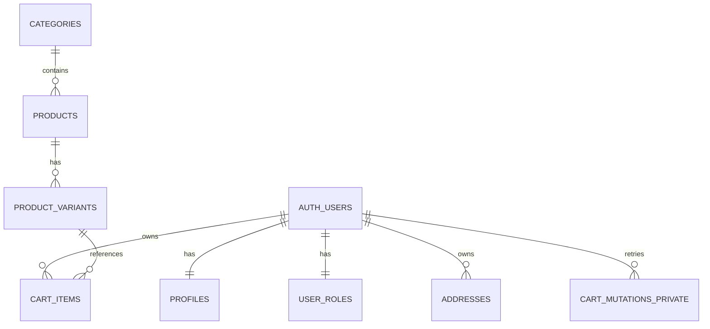

# Contract và schema bàn giao — 17/11/2026

Refs #2, #3. Code đối chiếu main `5dc2b77`; contract đơn/AI bên dưới là đề xuất S2, chưa phải implementation. Flutter 3.47.5/Dart 3.13.4, Riverpod; widget → domain → repository. Cấu hình client chỉ URL/publishable key, config local không commit.

| Module | Nguồn contract | Quy tắc |
|---|---|---|
| Catalog | `lib/features/catalog/domain/catalog.dart`, `catalog_query.dart`, `variant_selection.dart` | Giá integer VNĐ; size/màu cùng SKU; dùng variant ID, tồn >0; không viết lại repository catalog |
| Auth/Profile | `lib/features/auth/domain/`, `lib/features/profile/domain/profile.dart` | Auth giữ session; profiles giữ thông tin, user_roles giữ quyền; không tin role metadata client; response phiên cũ không ghi phiên mới |
| Cart | `lib/features/cart/domain/cart.dart` | RPC `get_cart` và mutation theo migration cart; caller auth.uid(), cùng user+variant gộp dòng; requestId chống cộng trùng; không tin giá/userId client |
| Addresses | `lib/features/addresses/domain/address.dart` | CRUD theo caller; selection local namespace user, xác minh lại server; xóa/đổi phiên bỏ selection stale; chọn địa chỉ chưa tạo đơn |

Avatar hiện là preset/đường dẫn có sẵn; reset gửi null, không biến đường dẫn lưu thành URL public. Chưa xác minh migration avatar Storage trên cloud, chưa có picker upload cá nhân.

## ERD nền đang có

Nguồn cột/constraint/index/policy: `supabase/migrations/20261108000100_initial_foundation.sql`, `20261108000200_demo_catalog.sql`, `20261109000100_product_cart.sql`. Catalog guest chỉ đọc dữ liệu hiển thị; admin ghi. Profiles/addresses/cart tách caller; user_roles client không tự ghi. `private.cart_mutations` giữ receipt (user_id, request_id), không expose Data API.

Cloud dev đã áp dụng migration nền/cart thủ công; chưa baseline CLI. Không chạy lại tạo bảng để reset. Seed ON CONFLICT DO NOTHING không khôi phục bản ghi đã sửa. Fixture SQL chỉ kiểm thử trong transaction rollback trên dev.

## Contract cần chốt 18/11

**Phúc: đơn COD, Quân review transaction.** Input chỉ địa chỉ thuộc caller, requestId và variant/dòng giỏ + quantity. Server đọc lại giá/hiển thị/stock, tính shipping theo rule, khóa dữ liệu cần thiết, lưu snapshot đơn/địa chỉ và trừ stock trong một transaction. Response gồm orderId, lines, shipping/total/status/time. Cùng requestId/payload trả cùng kết quả; payload khác cùng requestId phải bị từ chối. Client không quyết định role/trạng thái/giá. Chốt state machine trước UI; đánh giá chỉ sau đơn hoàn tất. Tên RPC/DTO/schema mới do Phúc đề xuất diff để ba người dùng chung, chưa ấn định tại tài liệu nền.

**Quân: AI, Hải review UI/contract.** Edge Function xác thực, nhận style/occasion/budget VND/free text giới hạn; Gemini key chỉ server. Response gồm giải thích, ID catalog hợp lệ, tổng giá và no-match/error. Server kiểm chứng schema/ID/stock/ngân sách; UI chọn variant trước thêm giỏ. Không giả AI online khi offline; fallback có nhãn đúng.

**Admin:** Hải catalog/Storage/cache; Phúc đơn/trạng thái/thống kê; Quân users/favorites/reviews/AI. Điều phối thứ tự migration và review trước áp dụng; thay route/DTO nêu ảnh hưởng trong PR. Timeout/permission/network có thông báo tiếng Việt; không báo success trước server.
