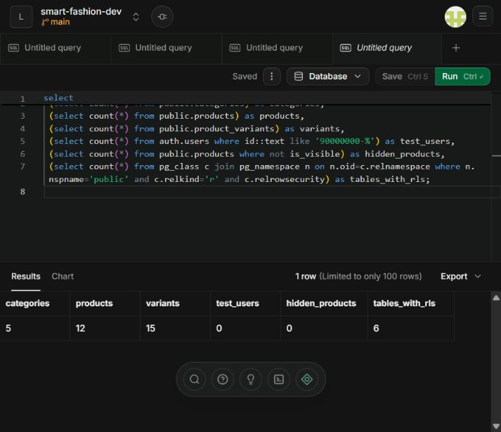
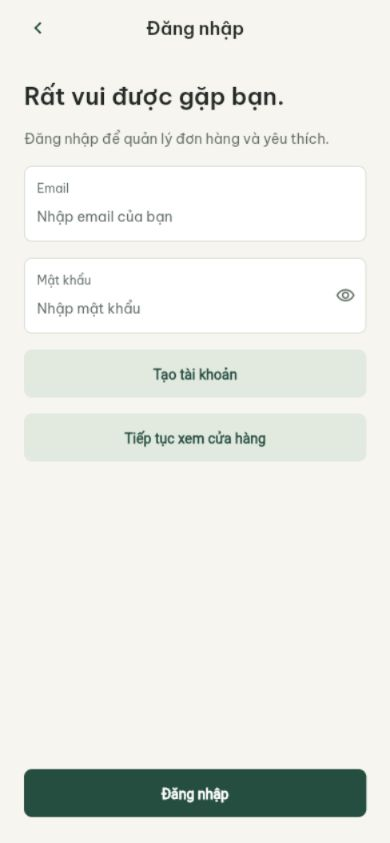
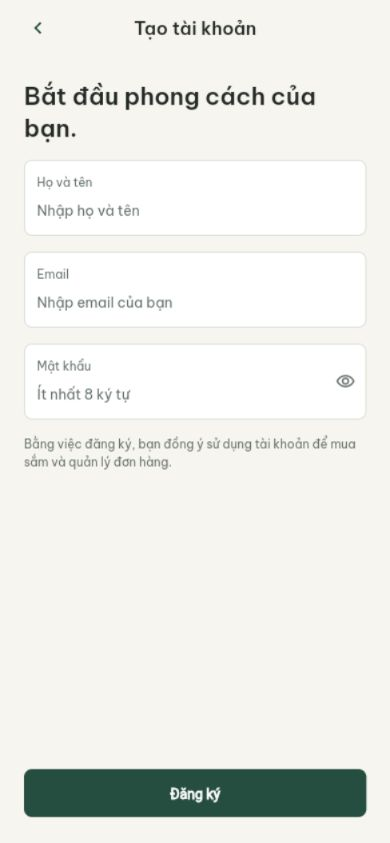
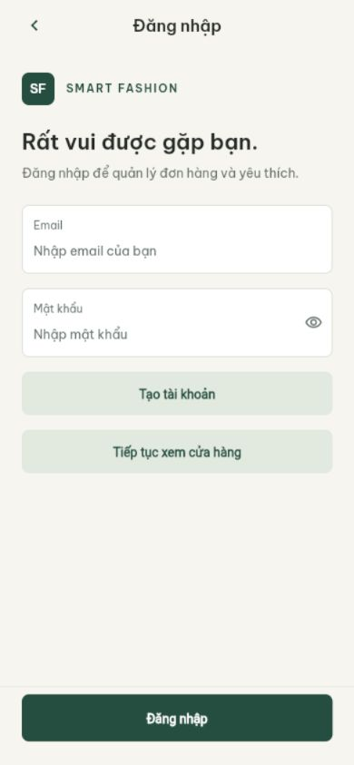
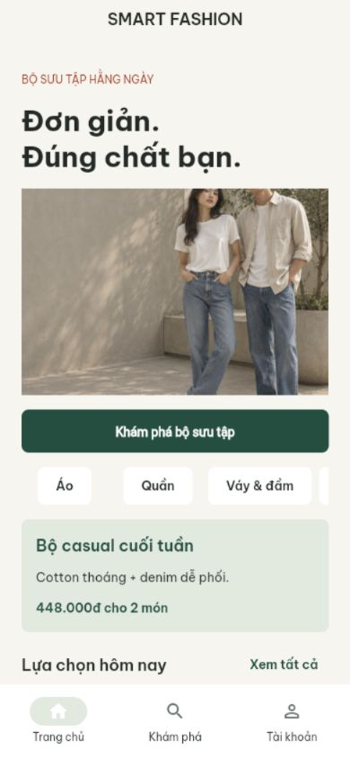
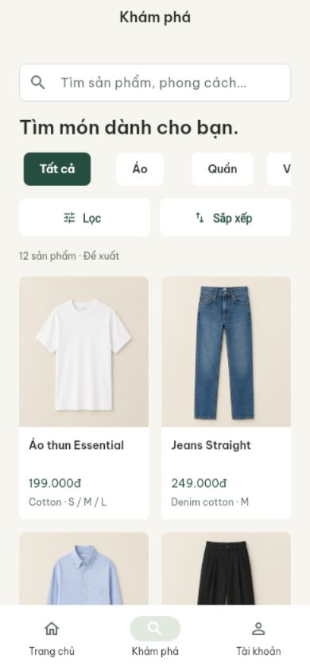
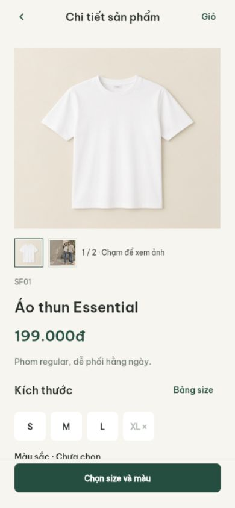
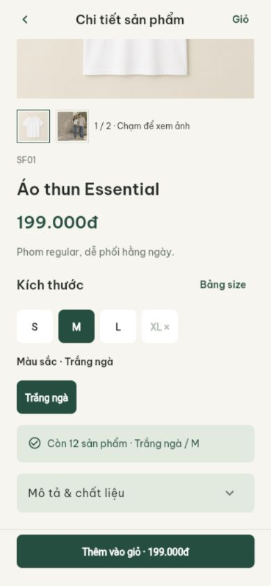

# Kết quả kiểm tra setup

Đây là lịch sử kiểm tra đến 09/11. Trạng thái bàn giao GitHub ngày 10/11 xem
[team-handoff](team-handoff.md), PR và Actions; các câu “chưa push” bên dưới
mô tả thời điểm cũ, không dùng làm trạng thái remote hiện tại.

Cập nhật gần nhất: 09/11/2026. Checkout: `chore/project-setup`, repository ban đầu
trống; chưa tạo commit, push, PR hoặc thay đổi GitHub Issues.

| Kiểm tra | Kết quả |
|---|---|
| Flutter / Dart | 3.47.5 stable / 3.13.4 |
| Dependencies đã khóa | `flutter pub get --enforce-lockfile` đạt |
| Format | 59 file Dart, không cần thay đổi ở lần kiểm tra chi tiết/giỏ cuối |
| Analyzer | Không có issue |
| Test | 60 test đạt: nền/Auth/catalog và chi tiết/giỏ/RPC/requestId/responsive |
| APK bàn giao mới | Release dev 0.1.3+4, 60.743.564 byte, `build/app/outputs/flutter-apk/Smart-Fashion-0.1.3.apk` |
| Android thật | Người dùng đã cài 0.1.3, thêm áo/jeans tổng 448.000đ và mở lại vẫn còn giỏ |
| Font trong APK | Đủ Be Vietnam Pro Regular/Medium/SemiBold/Bold |
| Web preview | Build thành công, `build/web/`; không còn cảnh báo thiếu font icon |
| Supabase cloud | Dev Singapore đã hoạt động; SQL/RLS, REST và SDK Flutter đạt (chi tiết bên dưới) |
| iOS | Scaffold đã tạo; chưa build do môi trường Windows |
| GitHub Actions | Workflow đã viết; chưa chạy trên GitHub vì chưa push |

Lỗi Kotlin incremental compilation khác ổ C/D ở lần build đầu đã được xử lý
trong cấu hình Android của project và build lại đạt. Không đổi cache chung.

Các mục ghi ngày 08/11 bên dưới là lịch sử kiểm tra ở thời điểm đó. Kết quả
Android và catalog mới nhất nằm trong các mục ngày 09/11 ở cuối tài liệu.

## Rà soát khả năng bàn giao và học code

Đợt rà soát ngày 08/11/2026 sau khi người dùng xác nhận chạy preview thành công:

- Đối chiếu brief Figma, kế hoạch R3, nhật ký điều chỉnh và các gói việc Sprint 1.
- Bổ sung tổng quan yêu cầu, hướng dẫn đọc code và hướng dẫn Windows/Android/iPhone.
- Sửa bảng phân công module theo R3; giải thích Q02 còn thiếu backend/schema/PR/CI thật.
- Hai script PowerShell đã qua kiểm tra cú pháp. `scripts/check.ps1` chạy đạt
  format, analyzer và cả 10 test.
- Chạy thử `flutter run -d web-server` với renderer local trên loopback.
  HTTP GET tới trang gốc, bootstrap, CanvasKit và font Be Vietnam Pro đều trả 200.
  Server kiểm tra chỉ bind localhost và đã được dừng sau khi kiểm tra.
- Chưa thử đường truyền Wi-Fi giữa máy Windows và iPhone, chưa thao tác Safari
  trên iPhone thật, chưa build/ký/cài iOS native. Hướng dẫn LAN cần được thử
  trên mạng và thiết bị của nhóm.

Không thay nội dung kế hoạch tháng, estimate hoặc GitHub Issues trong đợt rà soát.

## Chuẩn bị nền Supabase

- Đã thêm hai migration: schema/quyền và catalog demo (5 danh mục, 12 sản
  phẩm, 15 biến thể); chưa có Storage/ảnh hoặc nghiệp vụ đơn/AI.
- SQL đã chạy đạt trên PGlite với Auth fixture cục bộ: trigger tạo hồ sơ và
  customer, bỏ qua metadata nâng quyền, khách đọc catalog nhưng không sửa,
  customer không sửa catalog hoặc vai trò, A/B không truy cập địa chỉ nhau,
  admin sửa catalog, sản phẩm ẩn/danh mục ngừng ẩn cả biến thể, chặn giá bằng
  0/tồn âm/trùng biến thể. Transaction kiểm thử rollback đúng: còn 0 user
  fixture, 12 sản phẩm, 15 biến thể, 0 sản phẩm bị ẩn.
- PGlite và Auth stub chỉ nằm ngoài repository Flutter để kiểm tra; không
  được đưa Auth stub vào cloud. File `supabase/tests/foundation.sql` giữ
  các tình huống kiểm thử SQL để chạy lại trên project phát triển.
- Có `scripts/check-supabase.ps1` chỉ đọc Data API bằng publishable key và
  hướng dẫn `docs/supabase-setup.md`. Chưa coi script tồn tại là đã gọi cloud.

## Kết quả Supabase cloud

Ngày 08/11/2026, project `smart-fashion-dev`, ref `xvpdkbzdyevjbvvfeksc`,
tổ chức LeVanQuan Free; dashboard xác nhận Healthy, ap-southeast-1 Singapore.

- Đã áp dụng hai file SQL qua SQL Editor, mỗi file trong BEGIN/COMMIT;
  dashboard trả Success. Chưa ghi lịch sử migration CLI; cần baseline trước
  khi dùng CLI deploy sau này, không chạy lại migration cấu trúc.
- Bộ `supabase/tests/foundation.sql` chạy trên cloud và trả PASS. Sau
  ROLLBACK, query độc lập xác nhận 5 categories / 12 products / 15 variants /
  0 user fixture / 0 product ẩn / 6 bảng bật RLS.
- [Kết quả SQL/RLS](https://supabase.com/dashboard/project/xvpdkbzdyevjbvvfeksc/sql/775f93d3-7a4e-4068-90bc-a8fab47a219f)
  và [query xác minh sau rollback](https://supabase.com/dashboard/project/xvpdkbzdyevjbvvfeksc/sql/69bf1e6b-615b-49f8-a93b-671c16040729)
  đã được lưu trong SQL Editor. Không bấm Run lại migration đầu ở các tab khác.
- `scripts/check-supabase.ps1` gọi REST thật từ Windows: SF01 199000,
  SF02 249000, tổng 448000; 5 biến thể. Đạt sau khi sửa cách nhận mảng JSON
  từ Invoke-RestMethod. Lệnh cần quyền truy cập mạng của môi trường chạy.
- `flutter test tool/supabase_smoke_test.dart --no-pub
  --dart-define-from-file=config/development.local.json`: 1 test đạt với
  SupabaseClient thật. Đọc catalog/nested variants và bị từ chối SELECT
  profiles khi chưa đăng nhập (42501). SDK PostgREST hiện tại mặc định order
  giảm dần; test chỉ định `ascending: true` tường minh.
- File local đã có URL/publishable key và USE_SUPABASE=true; `git check-ignore`
  xác nhận file không được đưa vào Git. Không lưu database password hoặc
  secret/service-role key vào Flutter.
- Chưa tạo bucket ảnh, tài khoản Auth thật, cấp admin thật, cấu hình OAuth,
  SMTP, Edge Functions hoặc kiểm thử Auth trên Android/Safari thật.
- Sau thay đổi: `scripts/check.ps1` đạt format 15 file Dart, analyzer không
  có issue, 10 test mặc định đạt; kiểm tra SDK cloud riêng 1 test đạt. Ba
  script PowerShell kiểm tra cú pháp đạt. Chưa build lại APK/web trong đợt
  backend này; không thay UI hoặc dependency runtime.

## Module Auth theo Figma

Ngày 08/11/2026, dùng design context và screenshot từ Figma cho Login,
Register, ConfirmEmail, Logout cùng hai trạng thái lỗi. Các màn này không
có asset raster/SVG. Widget dùng Be Vietnam Pro bundle, theme/token chung;
đối chiếu browser thật ở 390×844. Không vẽ status bar giả; thao tác Giỏ và
menu hồ sơ/đơn hàng ngoài phạm vi Auth chưa tích hợp.

- `scripts/check.ps1`: format 31 file, analyzer không có issue, 23 test đạt.
  13 kiểm thử mới gồm validation/không gọi server, chặn gửi hai lần,
  lỗi vẫn giữ dữ liệu, ẩn/hiện mật khẩu, confirmation không phải session,
  resend cooldown, session/route/đăng xuất, khôi phục phiên, form ở 360/390/430
  với bàn phím và text scale 2, chặn next ra URL ngoài, HTTP payload và PKCE.
- Dependency `http` 1.6.0 được khai báo dev để dùng MockClient kiểm chứng
  request; đã có trong lockfile từ trước. Không thêm dependency runtime.
- Build web đạt, dùng renderer assets local; `build/web/`. Build APK debug
  đạt với config Supabase dev; `build/app/outputs/flutter-apk/app-debug.apk`.
- Dashboard: Email bật; Confirm email giữ bật; minimum password length đặt 8.
  Site URL đổi từ localhost:3000 sang `http://localhost:8080/`; allowlist có
  localhost:8080, 127.0.0.1:8080, IP Wi-Fi hiện tại 192.168.100.8:8080 và
  scheme Android `vn.edu.vku.smartfashion://auth-callback/`. Không dùng wildcard.
- Người dùng tự đăng ký, mở email xác nhận rồi đăng nhập bằng email chủ
  Supabase trong preview web. Đã quan sát `/account` hiển thị tên/email thật.
  Reload browser vẫn vào tài khoản. Hủy đăng xuất vẫn giữ phiên; xác nhận
  đăng xuất trở về Login. Vào thẳng `/#/account` sau đó bị redirect về Login.
- [Query chỉ đọc kiểm tra Auth](https://supabase.com/dashboard/project/xvpdkbzdyevjbvvfeksc/sql/12b33623-d1fb-4ec9-8e2a-346100d0f5d5)
  trả: 1 auth user, 1 email confirmed, 1 profile, 1 customer role, 0 admin.
  Như vậy trigger đã chạy từ đăng ký Auth thật; không tạo user bằng SQL trong
  phép kiểm chứng này. Không lưu password/token hoặc ảnh email cá nhân vào repo.
- Ảnh đối chiếu giao diện sạch và validation trong `docs/screenshots/`.
  Đã trả viewport browser về mặc định sau kiểm tra mobile.
- SMTP riêng chưa cấu hình: thư mặc định Supabase bị giới hạn tới email
  thành viên tổ chức. Chưa kiểm chứng đăng ký email ngoài tổ chức hoặc Safari
  iPhone thật. Chưa làm quên mật khẩu, sửa hồ sơ/avatar, cấp admin hay OAuth.
- Android V2452A đã kết nối ADB. Lần cài đầu bị điện thoại từ chối
  `INSTALL_FAILED_ABORTED: User rejected permissions`; đã báo người dùng.
  Sau khi người dùng báo sẵn sàng, đã thử lại bằng `adb install -r` (không tự
  uninstall); thiết bị vẫn trả cùng lỗi. Dừng retry. APK đã build, nhưng chưa
  xác minh khởi động, đăng nhập hoặc callback trên Android thật. Cần người
  sở hữu giải quyết quyền/xác nhận cài qua USB trên thiết bị trước khi thử tiếp.

## Sửa Auth Android và hoàn thiện UI — 09/11/2026

Triệu chứng người dùng xác nhận: APK hiển thị form nhưng báo “Tính năng tài
khoản chưa sẵn sàng”. Đối chiếu code: `USE_SUPABASE` mặc định false khi thiếu
dart-define, `supabaseClientProvider` trả null, repository không gọi Auth.

Đã sửa:

- `AppConfig.fromEnvironment()` mặc định dùng backend phát triển khi cả
  URL/key trống. Cấu hình client công khai ở `development_backend.dart`.
  Không dùng secret/service-role key. Nếu chỉ thiếu URL hoặc chỉ thiếu key
  thì vẫn báo cấu hình lỗi, không ghép project. Staging/production không
  được tự fallback về project dev. Offline phải chọn tường minh.
- Profile VS Code mặc định và script preview được cập nhật cùng quy tắc.
  `scripts/build-android.ps1` kiểm tra config local, chặn config tắt Auth,
  build/copy APK bàn giao có tên rõ ràng. Hai script qua kiểm tra cú pháp.
- UI giữ màu/font Figma; thêm nhận diện SF, focus border, loading/nút chính
  52px, xác nhận lại mật khẩu, thẻ email xác nhận và thông tin tài khoản.
  Email chuyển qua lại bằng route extra; password không chuyển route.
- Tách lỗi mail không được phép khỏi lỗi server chung để không báo nhầm
  lỗi gửi email cho mọi lỗi đăng nhập.

Kết quả:

- `scripts/check.ps1`: 32 file format đạt; analyzer không có issue; 28 test đạt.
- `flutter test tool/supabase_smoke_test.dart --no-pub` **không truyền config**:
  1 test đạt, SDK đọc catalog cloud thật và khách không đọc được profiles.
- Browser chạy bằng lệnh mặc định không truyền config: thử đăng nhập với
  địa chỉ `.invalid` không tồn tại, nhận đúng lỗi credentials từ Auth thay
  vì lỗi backend chưa sẵn sàng. Không tạo user hoặc gửi email trong test này.
- Đối chiếu UI browser 360/390/430; widget test thêm bàn phím và text scale 2.
  Đã lưu ảnh `auth-login-v2-390.png`, `auth-register-v2-390.png`,
  `auth-error-v2-390.png`. Trả viewport về mặc định, đóng tab và dừng server
  QA 8081 do tác vụ tạo; không dừng server khác của người dùng.
- Build `scripts/build-android.ps1 -Mode release` đạt. APK 54.560.791 byte,
  SHA256 `CE8161769D34820E5CC41837A3DD99F8519F0DC5948317D09A8B6C4E7EAC4B66`.
  Đây là release dùng project dev, hiện dùng debug signing key của scaffold;
  không phải bản Play Store đã ký production.
- `flutter build web --no-pub --no-web-resources-cdn` không truyền config
  cũng build đạt với mặc định mới; đầu ra mới nhất ở `build/web/`.
- Đã chép vào Android: `/sdcard/Download/Smart-Fashion-0.1.1.apk`.
  Người dùng tự cài đè và xác nhận **đăng nhập thành công trên Android**.
  ADB xác nhận versionName 0.1.1, versionCode 2. Không uninstall/xóa dữ liệu app.
- Người dùng chọn tiếp tục thử bằng email chủ Supabase, chưa cấu hình SMTP
  riêng. Chưa test tạo user mới trên Android bằng email ngoài tổ chức hoặc
  callback email native end-to-end; email chủ đã có tài khoản từ lần thử web.

## Home và catalog Supabase — 09/11/2026

Bản 0.1.2+3 triển khai Home/Explore theo context Figma, lấy categories,
products và nested product_variants qua Supabase SDK. Không sửa schema/RLS,
không thay dữ liệu demo, không thêm dependency runtime. Bỏ BootstrapPage;
route `/` mở Home và `/explore` mở danh sách công khai. Auth vẫn có guard.

- `scripts/check.ps1`: format 44 file Dart đạt, analyzer không có issue,
  **44 test đạt**. 16 test bổ sung bao gồm tìm không dấu/Unicode tổ hợp,
  price boundary, sort/collection, size+màu cùng SKU còn hàng, mapping VND
  và stock, HTTP phân trang/filter công khai, lỗi API, luồng tìm/lọc/đóng/
  áp dụng/đặt lại/xem nhanh, tải/lỗi/retry và giữ snapshot khi refresh lỗi;
  Home/Explore/filter ở 360/390/430 với text scale 2.
- Test HTTP dùng MockClient, gắn response.request và UTF-8 để tương thích
  PostgREST SDK; đây là fixture, không phải bằng chứng quyền cloud.
- `flutter test ...supabase_catalog_repository_test.dart
  tool/supabase_smoke_test.dart --no-pub`: 5 test đạt, gồm smoke cloud riêng.
  Repository thật đọc **5 danh mục, 12 sản phẩm, 15 biến thể**; tìm `ao thun`
  ra SF01; lọc XL không ra hàng; SF12 hết tồn. Khách SELECT profiles bị từ
  chối 42501. Không tạo user hoặc thay giá/tồn kho trong phép kiểm tra.
- `scripts/build-android.ps1 -Mode release` đạt: **59.465.332 byte**.
  APK có cả alias `smart-fashion-dev-release.apk` và `Smart-Fashion-0.1.2.apk`.
  SHA256 `58DDBBF96E5D1BB60959101BCBA4534FD84F9D94099EDDBE8D657D68CC99D0A0`.
  Bản release dùng backend dev và debug signing key của scaffold.
- Đã push `/sdcard/Download/Smart-Fashion-0.1.2.apk`. Người dùng tự cài đè
  và xác nhận **thấy sản phẩm và tìm kiếm được trên Android**. ADB xác nhận
  versionName 0.1.2 / versionCode 3. Không uninstall hoặc xóa dữ liệu app.
- `flutter build web --no-pub --no-web-resources-cdn` đạt; Wasm dry run đạt.
  Không coi dry run là đã kiểm thử bản `--wasm` riêng. Đầu ra `build/web/`.
- Browser 390×844: Home/Explore đọc catalog thật; tìm `ao thun` ra 1 sản
  phẩm, mở xem nhanh thấy giá/mô tả và S/M/L/XL theo dữ liệu. Bản web đóng
  gói cũng tải đủ 12 sản phẩm; áp dụng XL ra 0, Tìm lại khôi phục 12.
  Bộ lọc dùng đủ danh mục/size/màu hiện có, nội dung cuộn và nút áp dụng
  nằm cuối. Sắp Giá tăng dần trả 129k → 179k → 199k → … → 449k đúng dữ liệu;
  console không có warn/error trong phiên QA. Đã trả viewport mặc định và
  đóng tab QA, dừng Flutter server 8081 và static server do tác vụ tạo.
  Không dừng preview khác của người dùng. Ảnh tại `docs/screenshots/catalog-*.jpg`.
- Ảnh hero và atlas lấy nguyên bản Figma, đóng gói offline. Supabase
  `image_paths` hiện trống; **chưa tạo/upload Storage**. Nội dung sản phẩm,
  giá và tồn kho vẫn đến từ Supabase, không dùng fake catalog khi lỗi mạng.
- Giữ snapshot chỉ trong RAM của phiên, chưa có cache offline lưu bền.
  Bộ casual là collection biên tập; chưa gọi Gemini. Xem nhanh chỉ đọc,
  chưa phải toàn bộ chi tiết/chọn biến thể mua hàng/giỏ/checkout.
- iPhone Safari thật chưa được kiểm thử. Chưa commit/push, tạo PR, thay
  trạng thái Issue hoặc đánh dấu hoàn thành toàn bộ Q03/H02.

Hướng dẫn đọc code và demo: `docs/catalog-walkthrough.md`.

## Chi tiết sản phẩm, biến thể và giỏ Supabase — 09/11/2026

- Đọc context Figma Product/Ready/Jeans, Cart/Added/Empty, Material/SizeGuide.
  Thay khung xem nhanh bằng route `/products/:id`, đọc lại sản phẩm từ API.
  Gallery, chọn biến thể, tồn kho, mô tả, size guide và CTA đã hoạt động.
- Bổ sung cart_items, RLS chỉ chủ giỏ đọc, get_cart và mutate_cart;
  private.cart_mutations giữ biên nhận requestId. Không cho client ghi thẳng.
  Không nhận userId/giá từ client, không trừ tồn khi thêm giỏ.
- [Migration cloud](https://supabase.com/dashboard/project/xvpdkbzdyevjbvvfeksc/sql/671dd401-b82e-4b03-99e7-0f8e90bc71bd)
  đã chạy toàn file `20261109000100_product_cart.sql` trong BEGIN/COMMIT và
  trả Success. Không chạy lại migration tạo bảng. Chưa baseline lịch sử CLI.
- [Kiểm thử cart SQL/RLS](https://supabase.com/dashboard/project/xvpdkbzdyevjbvvfeksc/sql/482b755a-0094-4db3-bf21-fbc0f8b2f3f8)
  chạy toàn file `supabase/tests/cart.sql`, trả PASS. Kiểm tra anon bị từ chối,
  B không đọc giỏ A, cùng SKU cộng dồn/khác size tách dòng, stock/quantity,
  requestId không cộng trùng, chặn ghi thẳng, xử lý hàng ẩn và giá hiện tại.
  Tất cả fixture trong BEGIN/ROLLBACK. Cùng migration và test cũng đạt ở PGlite
  cục bộ; auth stub của PGlite không được đưa lên cloud.
- [Xác minh độc lập sau rollback](https://supabase.com/dashboard/project/xvpdkbzdyevjbvvfeksc/sql/9066dfba-a7eb-45f0-9747-66af518493ef)
  trả test_users=0 / test_cart_items=0 / test_receipts=0; giá SF01/SF02 vẫn
  199000/249000; cart_rls=true; anon_read_rpc=false; direct_client_insert=false.
- `scripts/check.ps1`: 59 file format đạt, analyzer không issue, **60 test đạt**.
  16 test mới gồm lựa chọn SKU, JSON/tổng/stock, RPC payload, chặn double submit,
  retry cùng requestId, chặn thao tác khác khi chưa xác nhận, đổi tài khoản lúc
  đang ghi, luồng guest-login-return/add/quantity/remove, gallery/size guide,
  chữ lớn 360/390/430. Test dùng fixture được tách khỏi bằng chứng cloud.
- `flutter test tool/supabase_smoke_test.dart --no-pub`: 1 test cloud đạt,
  đọc cả chi tiết SF01/4 biến thể; anon bị từ chối RPC get_cart/mutate_cart
  (42501), không tạo giỏ hoặc gửi email. Các kiểm tra catalog/profiles trước
  đó vẫn đạt. SDK thật dùng cấu hình dev mặc định.
- `uuid` 4.6.0 đã có trong lockfile dạng transitive, nay khai báo trực tiếp để
  tạo requestId; không nâng các thư viện runtime khác.
- `scripts/build-android.ps1 -Mode release` đạt: APK **60.743.564 byte**,
  SHA256 `6A8FB8933BFD08DEF12297FDDABB2119AFBD34F009859FCCFBE42093010DFE19`.
  Alias bàn giao `Smart-Fashion-0.1.3.apk` và `smart-fashion-dev-release.apk`.
  Vẫn là release dùng backend dev/debug signing của scaffold, chưa ký Play Store.
- Đã push `/sdcard/Download/Smart-Fashion-0.1.3.apk`. Người dùng tự cài đè,
  thêm áo M/Trắng ngà và jeans M/Xanh denim, xác nhận tổng **448.000đ** và
  đóng/mở lại vẫn còn giỏ. ADB xác nhận versionName 0.1.3 / versionCode 4.
  Không uninstall, xóa app data hoặc nhờ người dùng gửi mật khẩu.
- Web build `flutter build web --no-pub --no-web-resources-cdn` đạt; Wasm
  dry run đạt, chưa coi là đã test một bản `--wasm` riêng.
- Browser ở 390×844 dùng Supabase thật: SF01 giá 199000, M/Trắng ngà còn 12,
  XL khóa, gallery đổi ảnh, khách bấm thêm mở Login. Ảnh trong
  `docs/screenshots/product-*.jpg`. Đã so hash ảnh chi tiết/gallery với asset
  Figma mới tải: trùng chính xác atlas/campaign hiện có, dùng lại file.
- Một lần hot restart của web debug ghi assertion EngineFlutterView đã dispose.
  Đã kiểm tra lại bằng bản web release trong tab/origin mới: chọn M/Trắng ngà,
  CTA thêm và luồng khách mở Login chạy đúng, console warn/error rỗng.
  Ảnh chi tiết và biến thể cuối được lưu lại từ bản release. Trả viewport về
  mặc định, đóng các tab QA, dừng Flutter/static server do tác vụ tạo.
- Chưa có checkout/COD/đơn, yêu thích/đánh giá hoặc admin; giỏ chỉ giữ
  request đang chờ trong RAM, chưa có queue offline qua lần đóng app.
  Chưa test Safari iPhone thật/iOS native, chưa test hai thiết bị cập nhật đồng
  thời; server đã có lock để tuần tự hóa cập nhật cùng tài khoản.
- Chưa commit/push, tạo PR, thay GitHub Issues hoặc đánh dấu H02/P01 Done.

Hướng dẫn học và demo: `docs/product-cart-walkthrough.md`.

